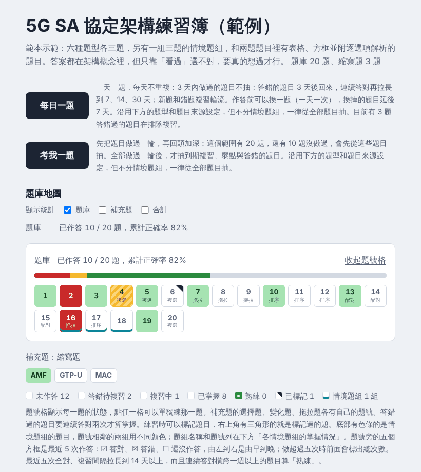

# 模擬考練習簿（Mock-Exam）

把題目寫成一份 JSON，就能產生一個可以直接用瀏覽器開啟的練習簿：單一 HTML 檔，不需要伺服器，也不需要安裝任何東西就能作答。

練習簿 = 固定的引擎（`assets/template.html`）+ 你的題庫（`bank.json`）。你只需要寫題庫，作答、判分、複習排程、模擬考、列印和同步都由引擎處理，所以每一份練習簿的功能都一樣。



目錄：

- [先看成品](#先看成品)
- [三種做法](#三種做法)
- [功能總覽](#功能總覽)
- [做一份自己的練習簿](#做一份自己的練習簿)
- [題庫怎麼寫](#題庫怎麼寫)
- [修改已經發出去的練習簿](#修改已經發出去的練習簿)
- [練習簿怎麼用（給作答的人）](#練習簿怎麼用給作答的人)
- [設定之間怎麼互相影響](#設定之間怎麼互相影響)
- [Claude skill](#claude-skill)
- [給維護的人](#給維護的人)
- [檔案說明](#檔案說明)
- [注意事項](#注意事項)

## 先看成品

下載 `assets/template.html`，用瀏覽器打開。它內含一份 20 題的範例題庫：六種題型各三題、一組三題的情境題組，以及兩題題目裡有表格、方框並附逐選項解析的題目，可以直接試用。

## 三種做法

| 你有 | 怎麼做 |
|---|---|
| Claude（claude.ai） | 下載 [`mock-exam-workbook.skill`](https://github.com/HelloNiHowMa/Mock-Exam/raw/main/mock-exam-workbook.skill) 安裝，上傳教材，Claude 會出題、檢查並發佈練習簿。步驟見 [`操作說明.md`](操作說明.md)「方法一」。 |
| ChatGPT、Copilot 等其他 AI | 用 [`PROMPT.md`](PROMPT.md) 請 AI 出題，再把題庫貼進範本，不需要 Python。步驟見 [`操作說明.md`](操作說明.md)「方法二」。 |
| Python 3，想自己寫題庫 | 照下面「做一份自己的練習簿」的步驟，用 `build.py` 產生。 |

## 功能總覽

「版本」是引擎從哪一版開始有這個功能。練習簿主頁最下方會寫它用的引擎版本；比表上舊的練習簿，用新範本重新產生就有（見「[修改已經發出去的練習簿](#修改已經發出去的練習簿)」）。「初版」指 2026-10-04 的引擎。

**題目和題庫**（出題的人在題庫裡設定）

| 功能 | 說明 | 版本 |
|---|---|---|
| 六種題型 | 單選、複選、分類（可以逐格判分）、排序、配對、縮寫 | 初版 |
| 易混淆題組 | 把容易搞混的題目綁在一起連續出，每題附「分辨關鍵」 | 初版 |
| 題目附圖、解析附圖 | `img` 作答前顯示，`eimg` 作答後才顯示；圖可以點一下放大 | 初版 |
| 爭議題 | `flag`：題庫地圖標紫色「!」，列印時也標註 | 2026-10-09 |
| 內建補充題 | 題號 1001 以上，題庫定稿後才加的題目，不影響題庫的統計 | 2026-10-09 |
| 不可作答 | `void`：發佈後才發現有問題的題目，留著但不出題、不計分 | 2026-10-10 |
| 依章節出題 | `chapters`：只練某幾章、各章節的掌握情況、模擬考照正式考試各章題數 | 2026-10-24 |
| 選項圖片 | `oimg`：選項本身是圖或表格 | 2026-10-24b |
| 情境題組 | `cases`：一段共用情境底下掛好幾題 | 2026-10-28 |
| 題幹區塊 | `blk`：題目裡的表格、方框、程式碼、圖、SVG | 2026-10-28b |
| 逐選項解析 | `oe`：逐一說明每個選項為什麼對或錯；`lo`、`k`、`ref` 標學習目標、認知層級和出處 | 2026-10-28b |
| 卷別與整套模擬考 | `sets`：照原卷順序限時考一整卷，記上次成績；可設非母語加時 | 2026-10-28b |

**練習和考試**

| 功能 | 說明 | 版本 |
|---|---|---|
| 練習、模擬考 | 練習每題看解析；模擬考交卷後才看答案，可以改答案、跳題、標記待檢查 | 初版 |
| 出題範圍 | 全部題目、錯題複習、弱點題、到期複習、易混淆題組、還沒做過、已標記 | 初版 |
| 題型篩選 | 主要題型（`mainLabel`）、縮寫題、拖拉題、全部題型；選擇會記住 | 初版（2026-10-20 起記住） |
| 題目來源 | 全部來源、只出題庫、只出補充題（縮寫題自成一類，不分來源） | 初版（只出題庫：2026-10-09；縮寫題自成一類：2026-10-29） |
| 先回想再看選項 | 先藏起選項，想好再顯示 | 初版 |
| 計時 | 不計時、正計時、倒計時；可以暫停，時間到可以選「繼續作答，計算超時」 | 初版 |
| 選項記號 | × 刪去、○ 標為可能；作答後提醒是不是刪掉了正解 | ×：初版，○：2026-10-09 |
| 這次不列入紀錄 | 手滑、用猜的時候，把這一次作答排除在紀錄外 | 初版 |
| 縮寫題「我其實答對了」 | 判定太嚴時自己改判答對 | 初版 |
| 縮寫題「遮住再打」 | 答錯後把全名打 3 次，第 2、3 次要憑記憶打 | 2026-10-16 |
| 打亂順序 | 選項、排序和分類項目、配對右欄都會打亂；列印也固定打亂 | 分類題和列印：2026-10-20 |
| 每日一題 | 一天一題，新題和錯題輪流；作答前可以換一題 | 初版（換一題：2026-10-23） |
| 考我一題 | 隨機抽一題，先把沒做過的抽完一輪再加深 | 初版（先抽沒做過：2026-10-09） |
| 考前快速瀏覽 | 答案直接顯示、不記錄作答，可以滑動換題、打亂順序 | 初版 |
| 列印 | 練習卷（答案附在最後）或複習講義（每題附答案與解析）；勾了略過已熟練時，列印也略過熟練的題目 | 初版（略過熟練題：2026-10-29） |

**追蹤和複習**

| 功能 | 說明 | 版本 |
|---|---|---|
| 題庫地圖 | 每題一格，顏色是狀態，旁邊是最近 5 次作答；點一格單獨練那一題 | 初版 |
| 間隔複習 | 答錯 10 分鐘後到期，連續答對拉長到 1、3、7、14、30 天 | 初版 |
| 弱點題 | 依最近五次作答排序，答錯越多、錯得越近的越前面 | 初版 |
| 熟練追蹤 | 最近五次全對、間隔 14 天以上、連續答對橫跨一週以上；練習和列印時可以略過 | 初版 |
| 誤選分析 | 每題記得答錯時選了什麼；主頁列出「最常誤選的答案」 | 初版 |
| 成績頁 | 答對題數、用時、最花時間的題目；各章節、各情境題組的結果 | 初版（章節：2026-10-24，情境題組：2026-10-28） |
| 未完成的練習 | 主頁提示上次沒做完的那一回，可以繼續或放棄 | 初版（做完沒看結果的提示：2026-10-09） |

**其他**

| 功能 | 說明 | 版本 |
|---|---|---|
| 補充題 | 作答的人在頁面上新增自己的選擇題、縮寫題、拖拉題 | 初版 |
| AI 解析 | 發佈成 Claude artifact 時，題目下方有「請 AI 解析這題」；補充題表單有「請 AI 幫忙寫」。題目改過之後，舊的解析會標出可能已經過時 | 初版（過時提醒：2026-10-29） |
| 帳號同步 | 發佈成 Claude artifact 時，作答紀錄跟著 Claude 帳號 | 初版 |
| 備份作答紀錄 | 匯出、匯入 JSON，換裝置或交給別人分析 | 2026-10-20b |
| 檢查新版 | 主頁最下方顯示引擎版本，按一下和 GitHub 比對 | 2026-10-20c |

每一版改了什麼的細節，寫在 `assets/template.html` 最上方的說明裡。

## 做一份自己的練習簿

需要什麼：

- **作答的人**：只要瀏覽器。
- **出題的人**：Python 3，用來執行 `scripts/build.py`，只用到標準函式庫。要讓它自動壓縮題目附圖的話再安裝 Pillow（`pip install pillow`），沒裝也能用。

下面的指令在 Windows 上請把 `python3` 換成 `python`。

### 1. 取得這個 repo

```bash
git clone -b main https://github.com/HelloNiHowMa/Mock-Exam.git
cd Mock-Exam
```

`main` 是穩定版；`dev` 是開發中的版本，也是這個 repo 的預設分支。

### 2. 寫題庫

建一個資料夾放題庫，例如 `my-workbook/bank.json`：

```json
{
  "config": {
    "id": "my-first-workbook",
    "title": "我的第一份練習簿",
    "subtitle": "示範用的兩題。"
  },
  "questions": [
    {"n": 1,
     "q": "瀏覽器送出請求後收到狀態碼 404，代表什麼？",
     "o": ["伺服器內部發生錯誤", "找不到請求的資源", "請求成功", "需要先登入"],
     "a": 1,
     "e": "404 Not Found 表示伺服器找不到這個網址對應的資源。\n容易卡住的地方：把 404 和 500 搞混。4 開頭是請求這一端的問題，5 開頭才是伺服器出錯。"},
    {"n": 2, "type": "order",
     "q": "把瀏覽器開啟一個 HTTPS 網頁的步驟排成正確順序。",
     "items": ["DNS 查詢網域的 IP", "建立 TCP 連線", "TLS 交握", "送出 HTTP 請求"],
     "e": "先知道對方在哪裡才能連線；連線建立後才做加密交握，最後才送出請求。\n容易卡住的地方：以為 TLS 交握在 TCP 連線之前。TLS 是跑在 TCP 上面的。"}
  ]
}
```

想從完整的例子開始改，範例題庫的原始檔就是 `assets/example-bank.json`，範例圖片在 `assets/example-images/`，複製一份來改就好。出題前建議先看 [`references/writing-guide.md`](references/writing-guide.md)，裡面有干擾選項和解析的寫法。

### 3. 檢查格式

```bash
python3 scripts/build.py --bank my-workbook/bank.json --check
```

- **錯誤**：格式不符，一定要修，否則不會產生檔案。
- **提醒**：格式沒問題，但可能影響出題品質，例如正確答案老是放在同一個位置。逐條判斷要不要改。

### 4. 產生練習簿

```bash
python3 scripts/build.py --bank my-workbook/bank.json --out my-workbook/練習簿.html
```

用瀏覽器打開 `my-workbook/練習簿.html` 就能作答。這個檔案可以直接傳給別人，或放到內部網站。

## 題庫怎麼寫

完整格式在 [`references/schema.md`](references/schema.md)，這裡只列重點。

| 區塊 | 內容 |
|---|---|
| `config` | 練習簿的設定。`id` 和 `title` 必填，其餘有預設值。及格線、每題秒數、AI 解析的講師角色、整套模擬考的時間等都在這裡，見 schema.md 第 1 節。 |
| `questions` | 題目。五種題型：單選 `mcq`（可省略 `type`）、複選 `multi`、分類 `cls`、排序 `order`、配對 `match`。 |
| `abbr` | 縮寫題：看到縮寫，寫出英文全名。可以不寫。 |
| `groups` | 易混淆題組：把容易搞混的題目綁在一起連續出題。可以不寫。 |
| `cases` | 情境題組：一段共用的情境文字（可以附圖）底下掛好幾題，作答時情境顯示在題目上方，題目只寫這一題要問的事。題目維持原本的題型和題號。教材沒有個案或情境就不寫。 |
| `chapters` | 章節：教材本來就分章節時，列出各章，題目用 `ch` 標出屬於哪一章；可以填正式考試各章的題數 `exam`，讓模擬考照這個比例出題。教材沒分章節就不寫。 |
| `sets` | 卷別：題庫是好幾份完整的考卷（例如官方範例試題 A 到 D 卷）時，列出各卷，題目用 `set` 標卷別、`no` 標卷內題號。主頁多「整套模擬考」。不是一卷一卷的題庫就不寫。 |

最容易出錯的幾件事：

- **答案位置從 0 開始**：`"a": 1` 是第二個選項。
- **選項照正確答案的順序寫就好**：選項、排序項目、配對右欄和分類題的項目，作答時都會自動打亂；列印時單選、複選和分類題的選項也會固定打亂。
- **題號 `n` 不能重複**：1 到 999 是題庫；1001 到 9998 是補充題，會另外排在補充題區；1000 不能用。
- **`config.id` 和題號發佈後不要改**：作答紀錄綁在這兩個值上，改了紀錄就接不回來。刪題就讓號碼空著，新題接在最大號後面。章節、情境題組和卷別的 `id` 也一樣，發佈後不要改。
- **不要用 Markdown 語法**：頁面會原樣顯示。解析要分段請用 `\n`。

### 加圖片

把圖片放在一個資料夾，檔名去掉副檔名就是代號，題目用 `img`（題目附圖）或 `eimg`（作答後才顯示的解析附圖）引用：

```json
{"n": 3, "q": "圖中標示問號的介面是？", "img": ["topo1"], "o": ["F1-C", "E1", "N2", "Xn-C"], "a": 0, "e": "……"}
```

```bash
python3 scripts/build.py --bank my-workbook/bank.json --images my-workbook/images --out my-workbook/練習簿.html
```

圖片會內嵌進 HTML，仍然是單一檔案。

### 題目裡的表格、log 和圖

題目本身有表格、log、程式碼或要夾在文字中間的圖時，用題幹區塊 `blk`：題目文字用 `{{0}}` 標出位置，`blk` 放 `table`、`box`（方框）、`pre`（程式碼）、`img`、`svg`。選項各錯在哪裡想分開講時，單選、複選題加 `oe`，照 `o` 的順序逐一說明（裡面不要寫 A、B、C，選項會打亂）：

```json
{"n": 19, "q": "同事整理的對照表如下：\n{{0}}\n哪一列記錯了？",
 "blk": [{"t": "table", "hr": 1, "rows": [["訊息", "記錄的介面"], ["NG SETUP REQUEST", "N2"], ["UE CONTEXT SETUP REQUEST", "N2"]]}],
 "o": ["第 1 列", "第 2 列"], "a": 1,
 "e": "……", "oe": ["NG SETUP 是 NGAP，走 N2，記得對。", "UE CONTEXT SETUP 是 F1AP，走 F1-C。"]}
```

格式見 [`references/schema.md`](references/schema.md) 2.7、2.8；什麼時候用 `blk`、什麼時候用附圖，見 [`references/writing-guide.md`](references/writing-guide.md)。

### 選項本身是圖

選項本身是圖或表格時（例如四張決策表選一張），單選、複選題用 `oimg` 放每個選項的圖，和 `o` 一樣長，沒有圖的選項寫 `null`；`o` 仍然要寫，當作每張圖的簡短說明：

```json
{"n": 21, "q": "依下列規則，哪一張決策表正確？",
 "o": ["表 1：兩個 input 欄、一個 output 欄", "表 2：一個 input 欄、一個 output 欄", "表 3：三個 input 欄、一個 output 欄", "表 4：兩個 input 欄、兩個 output 欄"],
 "oimg": ["dmn-t1", "dmn-t2", "dmn-t3", "dmn-t4"], "a": 0, "e": "……"}
```

同一題的選項圖片要用同一個畫布寬度輸出，圖裡不要畫 A、B、C（選項會打亂）。細節見 [`references/schema.md`](references/schema.md) 第 9 節。

## 修改已經發出去的練習簿

手上只有 HTML 也沒關係，先把題庫取出來，改完再重新產生：

```bash
python3 scripts/build.py --extract 舊練習簿.html --dump old
# 修改 old/bank.json
python3 scripts/build.py --bank old/bank.json --images-json old/images.json --out 新練習簿.html
```

同樣的步驟也能把舊練習簿升級到新版引擎：取出題庫，用新的範本重新產生。只要 `config.id` 和題號沒變，而且新檔案放在原本的位置（同一個網址，或更新同一個 artifact），原本的作答紀錄會接續下去。

之後再加這些都不影響作答紀錄：章節（`chapters`、`ch`）、情境題組（`cases`）、卷別（`sets`、`set`、`no`）、題幹區塊 `blk`、逐選項解析 `oe`、學習目標 `lo`、`k`、`ref`。

發出去之後才發現某一題不該出（不是教材裡的內容，或題目有錯、改不好），不要刪題，在那一題或那筆縮寫題加上 `"void": true` 和說明原因的 `"voidNote"`，把它標成不可作答。細節見 [`references/schema.md`](references/schema.md)「不可作答的題目」。

改了某一題的題目、選項或答案，題號沒變時要注意：作答的人之前在 Claude 上按過「請 AI 解析這題」的話，存下來的 AI 解析不會自動重寫。用引擎版本 2026-10-29 以後的範本重新產生，畫面會在這種解析上方標出「可能已經過時」，複習講義也不印；但 2026-10-29 以前存的解析沒有記下當時的題目內容，看不出來有沒有過時。所以改了題目內容時，還是請作答的人對改過的題目按「請 AI 重寫解析」。

## 練習簿怎麼用（給作答的人）

### 主頁

由上到下：

- **每日一題**：一天一題，每天不重複。3 天內做過的題目不抽；答錯的題目 3 天後回來，連續答對再拉長到 7、14、30 天；新題和錯題複習輪流出，當天的題目重開頁面也不會換。
  - 作答前，題目上方的「每日一題」標籤旁有「換一題」（一天一次），換成沒做過的新題（沒有新題時，換成很久沒做、沒答錯過的題目），不會換成其他排隊複習的錯題，也不會換成同一個易混淆題組的題目。換掉的題目 7 天後才會再出現在每日一題，作答紀錄不受影響；主頁會寫今天換掉哪一題、幾月幾日起才會再出現。作答後就不能換；考我一題和一般練習不受影響。
  - 有一回多題的練習還沒做完時，每日一題按不下去，要先繼續或放棄那一回。
- **考我一題**：隨機抽一題，答完可以一直「再來一題」。先把目前範圍裡還沒做過的題目抽完一輪，之後才抽到期複習、弱點和答錯的題目；按鈕旁會寫範圍內共幾題、還有幾題沒做過。
- **未完成的練習**：上次的練習沒做完時出現，可以「繼續練習」或「放棄這回」；全部答完但還沒看結果時，改成「看這回結果」。
- **整套模擬考**（題庫有卷別時才有）：每一卷一個按鈕，照原卷順序考一整卷，倒數計時、交卷後才看答案，按鈕上寫上次的成績和及不及格。附加題不在整套模擬考裡。題庫有設定非母語加時時，可以選加時後的考試時間，選擇會記住。
- **題庫地圖**：每個題號格的顏色代表狀態（未作答、答錯待複習、複習中、已掌握、熟練），點任一格可以單獨練那一題（不計時）。
  - 格子下方的小字是題型（複選、拖拉、排序、配對）；右上角三角形是已標記；左上角紫色「!」是爭議題；底部色條是情境題組。滑鼠停在格子上可以看最近 5 次作答。
  - 灰色、畫刪除線的是「不可作答」的題目：出題的人後來發現題目有問題，所以撤掉了。點進去會看到問題出在哪裡、原本的答案和解析，但不能作答；練習、模擬考和複習都不會出到它，也不計入題數和正確率。
  - 每一區上方有進度條和「收起題號格」，題數多時可以收起來。題庫有卷別時，題號格依卷別分組，格子上是卷內題號；有原創題時卷名旁標「內建」或「原創」。
  - 題庫下方依序是補充題的選擇題、拖拉題（有補充題時才有，各自從 1 編號），和縮寫題的方塊。有補充題或縮寫題時，「顯示統計」可以勾要看題庫、補充題、縮寫題或合計的作答統計；縮寫題自成一類，不算在補充題裡。
  - 題庫有分章節時，下方有「各章節的掌握情況」：每章已作答幾題、正確率和正式考試題數。點章節名稱就只練這一章。
  - 題庫有情境題組時，下方有「各情境題組的掌握情況」，點題組名稱就只練這一組。
  - 最下方是「新增補充題」和「管理補充題」，見下面「補充題」。
- **最常誤選的答案**（累積到答錯的紀錄才有）：統計各題最近五次作答中答錯時選了什麼。同一個答案在不同題目被誤選很多次，通常代表這個概念的邊界還不清楚；點一列可以集中練習相關的題目。
- **開始練習**：自己設定一回練習，見下一節。
- 最下方：同步狀態、「備份作答紀錄」、「清除所有進度」、引擎版本和「檢查新版」。

### 開始練習的設定

| 欄位 | 選項 | 會記住嗎 |
|---|---|---|
| 模式 | 練習（每題看解析）、模擬考（交卷後才看答案） | 會 |
| 模擬考題型 | 只在模擬考出現：單選、複選、分類、縮寫、排序與配對，可以複選。預設不勾縮寫題（輔助練習）。 | 會 |
| 題型 | 只在練習、而且有縮寫題或拖拉題時出現：主要題型（名稱由出題者設定，例如「觀念題」，包含縮寫題以外的所有題目）、縮寫題、拖拉題（分類、排序、配對）、全部題型 | 會 |
| 卷別 | 題庫有卷別時才有。選一卷，或「全部」。 | 不會，重新整理後回到「全部」 |
| 章節 | 題庫有分章節時才有。可以複選，不勾就是全部章節。 | 會 |
| 情境題組 | 題庫有情境題組時才有。可以複選要練哪幾組；「情境題組整組出」預設開著。 | 會 |
| 出題範圍 | 全部題目、錯題複習、弱點題、到期複習、易混淆題組、還沒做過、已標記。選「全部題目」練習時，可以勾「略過已熟練的題目」（預設勾選）。 | 範圍不會，略過已熟練會 |
| 題目來源 | 有補充題時才有：全部來源、只出題庫、只出補充題。縮寫題（題庫裡的和自己新增的）只在「全部來源」時出現。 | 不會 |
| 題數 | 10、20、50 題或全部。有整套模擬考時，50 題換成一卷的題數（例如 40 題）。模擬考時，題庫有填正式考試各章題數的話，多一個「照正式考試」：從勾選的章節各抽正式考試的題數，某一章題目不夠時有幾題出幾題，說明會寫少了幾題。選「易混淆題組」時改成選題組數：3 組、5 組或全部。 | 不會 |
| 作答方式 | 只在練習出現：先回想再看選項、直接看選項 | 會 |
| 計時 | 不計時、正計時、倒計時。倒計時要再選每題秒數（45、60、90 秒和出題者建議的秒數，有設定非母語加時時再多一個加時後的秒數）。 | 會 |

- 選「弱點題」時會先列出這回會出哪幾題；選「易混淆題組」時會列出各組，點一組可以直接練。
- 計時只算作答時間：看解析時、按下暫停或離開頁面時都會停止。
- 下方的「考前快速瀏覽這個範圍」和「列印這個範圍的題目」用的是同一組設定，見下面「考前快速瀏覽和列印」。

### 作答時

- 選項右邊的 **×** 標記「不是答案」，**○** 標記「可能是答案」，兩者互斥。它們只是作答當下的記號，不影響紀錄；作答後如果刪掉了正解，或把正解標成可能卻沒選，頁面會提醒。
- 「先回想再看選項」時，選項先藏起來，可以把想到的答案打在框裡（可以不寫），按「顯示選項」再作答。
- 複選題勾好再按「送出答案」，答錯時會寫出漏選和多選了哪幾個。拖拉題：分類題先點項目再點格子，排序和配對題拖曳把手或用 ↑ ↓ 調整，排好按「送出答案」。
- 縮寫題輸入英文全名後按 Enter，大小寫、標點、連字號和單複數都不影響判定；想不起來可以「直接看答案」（記為答錯）。判錯但其實寫對了（例如另一種合理的寫法），按「我其實答對了」改判。
- 縮寫題答錯或直接看答案後，答案下方出現「遮住再打」3 格：第 1 次看著答案打，第 2、3 次答案和解析先遮住，要憑記憶打。每打完一格就判定，打錯會標出打錯和漏掉的字，對照後按「遮住再打一次」重打。答對的縮寫題也可以按「再練一次」打開。這只是練習，不記錄；模擬考裡沒有。
- 作答後顯示解析、逐選項解析、解析附圖和學習目標，下面還有：
  - 這題以前答錯時選過什麼（誤選分析）。
  - 下次複習的時間。
  - 「這次不列入紀錄」：手滑或用猜的時候按，這次作答就不算，題目的狀態回到作答前；按「改回列入紀錄」恢復。題目標題旁最後一格方框也可以按。只能在這一回練習裡改。
  - 屬於易混淆題組時，附上這組的「分辨關鍵」。
  - 發佈在 Claude 時的「AI 解析」，見下面。
- 題目標題旁的五格方框是最近 5 次作答（☑ 答對、☒ 答錯、☐ 還沒作答）；作答前旁邊還會標出上次答錯、複習中、已掌握或熟練。「標記這題」之後可以用「已標記」範圍集中練。
- 情境題組的題目上方顯示情境，標出「情境：題組名稱（第 2／5 題）」。同一組連續作答時情境不會重新載入，捲到哪裡也不變；情境太長時在區塊裡捲動，也可以按「收起情境」，每一組各自記住。
- 題目裡的表格太寬時在表格裡左右捲動；題目裡的圖可以點一下放大。有逐選項解析的題目，字母照這次畫面上的順序；考前快速瀏覽、交卷後檢討和列印的複習講義也有逐選項解析。
- 題目旁的小標籤寫出來源：題庫、補充題，或出題者設定的卷別說法（例如「官方範例題」「原創練習題」）。題庫裡的縮寫題標「題庫」，自己在頁面上新增的題目標「補充題」。
- 頁面跟著裝置的深色模式切換；題目裡白底黑線的圖在深色模式下會反白顯示。
- 計時中可以按「暫停」，題目會先藏起來。倒計時用完時可以「結束並看結果」，或「繼續作答，計算超時」。
- 答錯過的題目要連續答對兩次才算掌握，之後複習間隔會逐步拉長。

### 模擬考和整套模擬考

- 作答時不顯示對錯，可以改答案、跳題，用「標記待檢查」標出要回頭看的題目。下方的「題目導覽」顯示每一題是否已作答、有沒有標記，點一下跳過去。
- 拖拉題移動過就算已作答。縮寫題直接輸入，可以改。
- 「交卷」要按兩次確認；還有沒作答的題目時會寫出幾題。交卷後才一次記錄成績，沒作答的題目算答錯。
- 題庫有情境題組時，模擬考以題組為單位抽題、不拆開，實際題數可能和設定的差幾題，成績頁會寫出來。
- 整套模擬考照原卷題號順序出題，不套用「開始練習」的任何篩選。

### 成績頁

- 答對幾題；模擬考另外寫得分、有沒有達到及格線（整套模擬考和有設定 `passCount` 的練習簿會寫「這回要答對幾題」），模擬考有「逐題檢討」。
- 有計時的話，寫出作答用時、平均每題時間、是否超時，以及最花時間的前三題。
- 出到兩個以上章節時列出各章節的結果；出到情境題組時列出各情境題組的結果。
- 答錯的題目列在下方，點一題可以再練（模擬考則是直接看那題的檢討），也可以按「再練這回答錯的 N 題」。

### 考前快速瀏覽和列印

- **考前快速瀏覽**：答案直接顯示、不記錄作答。用 ← → 或在手機上左右滑動換題，E 顯示或隱藏解析，M 標記；可以「打亂順序」。看完可以從頭再看一次。
- **列印**：有兩種格式。「練習卷」答案附在最後，有姓名和得分欄；「複習講義」每題附答案和解析（含這台裝置存的 AI 解析，已經過時的不印）。按「列印」用瀏覽器列印；發佈在 Claude、有下載能力時，也可以「下載列印檔（HTML）」再列印或存成 PDF。
- 兩者都照目前的出題範圍、題型、題目來源、卷別、章節和情境題組。同一個情境題組的題目排在一起，情境只出現一次。
- 「全部題目」練習時勾了「略過已熟練的題目」，列印也略過熟練的題目，列印頁會寫出略過幾題；考前快速瀏覽不略過。

### 補充題

作答的人可以在頁面上新增自己的題目：主頁題庫地圖下方按「新增補充題」，可以建選擇題（單選或複選，最多 6 個選項，可以標為爭議題）、縮寫題（可以列其他可接受的寫法）或拖拉題（排序或配對，最多 10 項）。「儲存並新增下一題」可以連續建；「管理補充題」列出所有補充題，可以練習、編輯或刪除（刪除要按兩次確認）。

補充題存在自己的作答紀錄裡，跟著帳號同步，練習方式和題庫的題目一樣；有補充題時，「開始練習」多一個「題目來源」。發佈在 Claude 時，解析欄旁邊有「請 AI 幫忙寫」。

### AI 解析（發佈在 Claude 時）

- 單選和複選題作答後，下方有「請 AI 解析這題」，寫好後可以「請 AI 重寫解析」，撰寫中可以停止。題目有附圖時，會盡量把圖一起給 AI 看。
- 用的是作答者自己的 Claude 用量，只有按下才呼叫。
- 寫好的解析存在這台裝置，也跟著帳號同步，下次直接顯示。它是照題號存的，不在備份檔裡，「清除所有進度」也不會清掉。
- 解析會連同當時的題目內容一起記下來（引擎版本 2026-10-29 起）。出題者之後改了這題的題目、選項、答案、題幹區塊、所屬情境，或換了附圖的代號，解析上方會標出「可能已經過時」，按「請 AI 重寫解析」就會更新；過時的解析不會印進複習講義。只改解析、章節或卷別不算改題目。2026-10-29 以前存的解析沒有記下題目內容，照常顯示。
- 放在其他地方的練習簿沒有這個按鈕，其他功能不受影響。

### 鍵盤快速鍵

| 畫面 | 按鍵 |
|---|---|
| 練習：單選題 | 1–6 或 A–F 作答；Shift + 數字刪去選項；Shift + 字母標為可能；M 標記 |
| 練習：複選題 | 數字或字母勾選；Enter 送出；Shift 組合和 M 同上 |
| 練習：先回想再看選項 | Enter 顯示選項 |
| 練習：縮寫題 | 輸入後 Enter 送出；遮住再打的格子裡 Enter 判定 |
| 練習：分類題 | Esc 取消選取的項目 |
| 練習：作答後 | Enter 或 → 下一題 |
| 練習：多題的一回 | ← 上一題；還沒作答時 → 跳過這題 |
| 模擬考 | 1–6 或 A–F 選答案（可以改）；← → 或 Enter 換題；Shift 組合和 M 同上 |
| 考前快速瀏覽 | ← → 換題；E 顯示或隱藏解析；M 標記 |
| 放大的圖片 | Esc 關閉 |

### 作答紀錄存在哪裡

紀錄存在這台裝置的瀏覽器裡，不會傳到任何地方。換瀏覽器、換裝置，或清除瀏覽器資料，紀錄就不在了。

練習簿發佈成 Claude artifact 時，紀錄會改成跟著帳號同步，主頁最下方會寫「進度會同步到你的 Claude 帳號」；題目解析旁也會多一個「AI 解析」按鈕。放在其他地方時這兩項自動隱藏，不影響作答。

### 備份和搬移作答紀錄

主頁最下方的「備份作答紀錄」可以把紀錄匯出成一個 JSON 檔（`<config.id>-progress-YYYYMMDD.json`），或複製到剪貼簿。到另一台裝置或另一個瀏覽器打開同一份練習簿，在同一個地方選檔案或貼上內容就能匯入。

- 匯入是合併，不是覆蓋：同一題保留時間較新的那筆，舊的備份不會蓋掉之後的作答。按下確認前，畫面會先列出會新增、更新哪些紀錄。
- 按過「清除所有進度」之後，清除前的紀錄不會再匯入，清除前存的備份也一樣。
- 備份來自另一份練習簿（`id` 不同）時會先警告：紀錄是照題號存的，匯入後會掛到這裡同號的題目上。
- 發佈在 Claude 的練習簿要宣告 `downloads` 能力才能下載檔案；不能下載時改用「複製到剪貼簿」，再貼到記事本存成 `.json`。
- AI 解析不在備份檔裡。

備份檔的欄位、題號的編法和合併規則見 [`references/progress-format.md`](references/progress-format.md)，要自己分析作答情形時可以參考。

### 清除所有進度

主頁最下方的「清除所有進度」要按兩次才會執行（4 秒內）。會清掉作答紀錄、標記、設定和沒做完的練習；**自己新增的補充題和存下來的 AI 解析會留著**。發佈在 Claude 的練習簿會同步到其他裝置，清除前的紀錄之後也不會再從帳號或備份檔回來。

### 看版本、檢查新版

主頁最下方寫著這份練習簿的引擎版本，按旁邊的「檢查新版」會讀 GitHub 上 `main` 分支的 [`VERSION`](VERSION) 來比對，只有按下才連線。發佈在 Claude 的練習簿可能不能連外，連不到時會給 GitHub 的連結。有新版時，練習簿要用新範本重新產生才會更新。

## 設定之間怎麼互相影響

這些是刻意的設計，但容易誤會：

- **每日一題和考我一題**照「開始練習」的題型和題目來源出題，但**不分卷別、章節、情境題組**，一律從全部題目抽。它們在主頁最上方、按下就出題，所以不受下方卷別、章節、情境題組的勾選影響。
- **有些設定會記住、有些不會**：模式、題型、章節、情境題組、作答方式、計時會記住（跟著帳號同步）；卷別、出題範圍、題目來源和題數不會，重新整理後回到預設。完整清單見上面「開始練習的設定」。
- **選了某一卷**時，沒有卷別的題目、補充題和縮寫題都不會出現。卷別、章節和情境題組可以同時用，三個條件都符合的題目才會出。
- **略過已熟練的題目**預設勾選，只在「全部題目」的練習和列印生效；模擬考、其他出題範圍和考前快速瀏覽都不略過。
- **縮寫題自成一類**：主頁標題、統計列和題庫地圖都把縮寫題和補充題分開算；「題目來源」選只出題庫或只出補充題時，不會出到縮寫題。
- **情境題組整組出**只在出題範圍是全部題目、還沒做過或已標記時整組出；錯題複習、弱點題、到期複習、考我一題、每日一題和易混淆題組一次出一題，但一樣顯示情境。模擬考一律整組出、不拆開。
- **兩套複習排程互不相干**：「到期複習」是答錯 10 分鐘後到期、之後 1、3、7、14、30 天；「每日一題」是自己的排程，答錯 3 天後回來、之後 7、14、30 天。同一題可能同時排在兩邊。
- **整套模擬考**不套用「開始練習」的任何篩選（題型、章節、情境題組都不管），照原卷題號順序出題，附加題和不可作答的題目除外。
- **不可作答優先於爭議題**：兩個都標時以不可作答為準。
- **有一回多題的練習還沒做完**時，每日一題暫時按不下去。
- **帳號同步時，設定是整包取較新的**：在 A 裝置做完每日一題後，B 裝置沒重新整理就改了任何設定，會把「今天已做完」蓋回去。這是已知問題 KI-001，換裝置前先重新整理就能避開。

目前還沒修的衝突只剩 KI-001（每日一題：跨裝置可能重複作答同一題，換一題也可能被蓋掉）。2026-10-28 整理時查到的 KI-004（列印題數和連結對不上）、KI-005（縮寫題被算成補充題）、KI-006（題目改過，舊的 AI 解析還在）已在引擎版本 2026-10-29 修好，已發佈的練習簿用新範本重新產生才會生效。細節見 [`known-issues.md`](known-issues.md)。

## Claude skill

repo 根目錄的 `mock-exam-workbook.skill` 是打包好的 Claude skill，[直接下載](https://github.com/HelloNiHowMa/Mock-Exam/raw/main/mock-exam-workbook.skill)就能安裝，安裝方式見 [`操作說明.md`](操作說明.md)「方法一」。

Claude 每次用 skill 出題或改練習簿前，會先執行 `scripts/check_update.py`，比對安裝的範本和 `main` 的 `VERSION`；安裝的版本較舊時，會在回覆裡提醒使用者重新下載安裝。

## 給維護的人

repo 的根目錄就是 skill 的資料夾：`SKILL.md` 告訴 Claude 怎麼出題，打包時放進 skill 的還有 `assets/`、`references/`、`scripts/build.py` 和 `scripts/check_update.py`。README、操作說明、`PROMPT.md`、`known-issues.md` 這些給人看的文件不會打包進去。

下面這三個路徑已經寫在發出去的練習簿和下載連結裡，**不要搬動或改名**：

- `VERSION`：練習簿的「檢查新版」和 `check_update.py` 讀 `main` 上的這個檔。
- `assets/template.html`：`main` 還沒有 `VERSION` 時的備用比對來源，也是 skill 的範本。
- `mock-exam-workbook.skill`：各份文件和 `check_update.py` 的下載連結都指到 `main` 上的這個檔。

### 分支和發佈

- 功能分支 → 開 PR 到 `dev`（預設分支）。
- 要發佈時，開 `dev` → `main` 的 PR（標題慣例是「發佈到 main：……（引擎版本 ……）」）。合併到 `main` 之後，大家的「檢查新版」就會看到，下載連結也會拿到新的 skill。
- 合併完的功能分支可以刪掉。

### 改版檢查清單

1. 改 `assets/template.html` 的程式時，要升引擎版本：範本最上方說明的「引擎版本」、程式裡的 `ENGINE_VERSION` 和根目錄的 `VERSION` 三個地方要一樣，`package_skill.py` 會檢查，對不上就不打包。版本是日期，同一天改好幾次就加 b、c。改了什麼寫在範本最上方的說明裡。
2. 改了範例題庫時，改 `assets/example-bank.json`（和 `assets/example-images/`），再用 `build.py` 放回範本，兩邊才會一樣：

   ```bash
   python3 scripts/build.py --bank assets/example-bank.json --images assets/example-images --out assets/template.html
   ```

3. 題庫格式有變：同時改 `build.py` 的檢查、`references/schema.md` 和 `PROMPT.md` 的格式段落。
4. 作答紀錄或設定（prefs）有變：改 `references/progress-format.md`；設定存在 prefs 的新功能，要在 `known-issues.md` KI-001 補一筆。
5. 更新這份 README 的「功能總覽」、`操作說明.md`，以及 `SKILL.md` 裡相關的步驟。
6. 重新打包，把新的 `mock-exam-workbook.skill` 和改動放在同一個 commit：

   ```bash
   python3 scripts/package_skill.py          # 重新產生根目錄的 mock-exam-workbook.skill
   python3 scripts/package_skill.py --check  # 檢查 skill 檔有沒有跟上目前的檔案
   ```

打包時檔案的時間戳記是固定的，內容沒變就會產生一模一樣的檔案，所以只有真的改了東西，skill 檔才會出現在 diff 裡。

### 引擎有、但還沒有流程用到的功能

這些程式在範本裡，但目前沒有文件或 skill 步驟會用到，細節見 [`known-issues.md`](known-issues.md)「維護備忘」：

- **題目匯入收件匣**：練習簿發佈在 Claude 時，開啟頁面會讀這個使用者的 `<config.id>-inbox` 文件，把裡面的 `extras`（補充題）和 `groups`（自訂易混淆題組）依修改時間併進作答紀錄。「變化題」（補充題帶 `from`，標「變化自第 N 題」，題目來源多「只出變化題」）和題組旁的「補充」標籤只會從這裡來。
- **看圖自評的拖拉題**（`imgdd`）：題庫和 `build.py` 都不接受這個題型，程式走不到。

## 檔案說明

| 路徑 | 內容 |
|---|---|
| `assets/template.html` | 範本引擎，內含範例題庫。不需要修改，題庫由 `build.py` 放進去。 |
| `assets/example-bank.json`、`assets/example-images/` | 範例題庫的原始檔和圖片，和範本裡的內容相同。 |
| `scripts/build.py` | 檢查題庫、產生練習簿、從現有練習簿取出題庫。 |
| `scripts/check_update.py` | 比對範本和 GitHub `main` 的引擎版本；Claude skill 開工前會先執行。 |
| `scripts/package_skill.py` | 把 repo 打包成 `mock-exam-workbook.skill`；`--check` 檢查 skill 檔有沒有跟上。 |
| `references/schema.md` | 題庫格式的完整說明。 |
| `references/writing-guide.md` | 出題指引：干擾選項、解析寫法、題型選擇。 |
| `references/progress-format.md` | 作答紀錄備份檔（匯出的 JSON）的格式和匯入時的合併規則。 |
| `SKILL.md` | Claude skill 的說明，打包時放進 skill。 |
| `mock-exam-workbook.skill` | 打包好的 Claude skill，下載後直接安裝。 |
| `VERSION` | `main` 上的引擎版本，練習簿的「檢查新版」和 `check_update.py` 都讀這個檔。 |
| `PROMPT.md` | 給 ChatGPT、Copilot 等其他 AI 用的出題提示詞。 |
| `操作說明.md` | 給各單位的操作步驟：用 Claude、用其他 AI、放到內部網站、備份作答紀錄。 |
| `known-issues.md` | 已知問題、避法和維護備忘。 |
| `docs/home.png` | README 用的主頁截圖。 |

## 注意事項

- 要分享給別人的練習簿，不要放考古題、原廠題庫或商業題庫的原文。從官方範例試題取題時，用 config 的 `notice`、`printNotice` 寫清楚來源和著作權。
- 已知問題和避法寫在 [`known-issues.md`](known-issues.md)。
